# ServiceOS Frontend: Complete Engineering Master Plan & Daily Sprint Roadmap

> **Platform:** ServiceOS — Multi-Tenant B2B2C Operating System for Field Service Enterprises  
> **Tech Stack:** Next.js (App Router), React 19, TypeScript, TailwindCSS v4, Axios, Socket.io-client, Lucide Icons  
> **Target Audiences:** 
> 1. **Tenant Business Backoffice** (`/app/*`): Owner, Admin, Manager, Finance, Sales  
> 2. **Tenant-Branded Customer Portal** (`/s/:tenantSlug/*`): End customers (Solar / HVAC asset owners)  
> 3. **Technician Mobile PWA** (`/tech/*`): Field workers & blue-collar technicians  
> 4. **Corporate HQ God-View** (`/hq/*`): Franchisor & multi-branch enterprise executives  
> 5. **Platform Super Admin** (`/platform-admin/*`): ServiceOS platform operators  

---

## 🏗️ Architectural Foundations & Core Design Patterns

### 1. Multi-Experience Monorepo Architecture
Rather than building 4 isolated apps, `service-frontend` implements a unified, route-segmented application using Next.js App Router:
```text
service-frontend/
├── app/
│   ├── (auth)/                  # Staff, HQ & Platform Authentication
│   │   ├── login/
│   │   ├── register/
│   │   └── forgot-password/
│   ├── (backoffice)/app/        # Tenant Operations Portal (RBAC Protected)
│   │   ├── dashboard/
│   │   ├── customers/
│   │   ├── quotes/
│   │   ├── invoices/
│   │   ├── dispatch/
│   │   ├── assets/
│   │   ├── maintenance/
│   │   ├── support/
│   │   ├── hr/
│   │   ├── wallet/
│   │   └── settings/
│   ├── (hq)/hq/                 # Enterprise Corporate God-View (HQ Franchisor)
│   │   ├── dashboard/
│   │   ├── branches/
│   │   ├── announcements/
│   │   ├── escalation-tickets/
│   │   ├── proxy-verification/
│   │   ├── supply-chain/
│   │   └── royalties/
│   ├── (tech)/tech/             # Mobile-First PWA for Field Technicians
│   │   ├── login/               # Passwordless 4-Digit SMS PIN Auth
│   │   ├── terms/               # "Big Button" Legal Compensation Acknowledgment
│   │   ├── jobs/                # Assigned Jobs, En Route, GPS Check-In, Checklists
│   │   ├── completion/          # OTP Verification, Signature Canvas, Photo Upload
│   │   └── wallet/              # Personal Earnings, Bank Setup, Payout Withdrawal
│   └── (portal)/s/[tenantSlug]/ # White-Labeled Customer Portal
│       ├── (auth)/login/        # Passwordless Customer OTP (Phone / Email)
│       ├── invite/[token]/      # Contextual Invitation Claim & Verification
│       ├── dashboard/           # Asset Status, System Specs, Service Timeline
│       ├── quotes/[id]/         # Interactive Quote Review, Digital T&C Signing, Escrow Deposit
│       ├── invoices/[id]/       # Invoice View & Gateway Checkout (Paystack / Stripe)
│       ├── track/[jobId]/       # Uber-style Live Technician Map & Status
│       └── support/             # Tickets, Warranty Claims & Billing Dispute Protection
├── components/
│   ├── ui/                      # Base Design System Atoms (Buttons, Inputs, Modals, Tables, Cards)
│   ├── shared/                  # Common Navigation, Headers, Tenant Switchers, File Uploaders
│   └── providers/               # React Query / SWR, AuthContext, SocketProvider, ThemeProvider
├── lib/
│   ├── api/                     # Axios Client with Auto JWT Interceptors & Error Handlers
│   ├── socket/                  # Real-Time WebSocket Client & Room Subscriptions
│   ├── utils/                   # Currency (NGN/USD), Date Formats, Phone Normalization (+234)
│   └── hooks/                   # Custom Hooks (useAuth, useTenant, usePermissions, useWallet)
```

### 2. White-Labeling & Dynamic Tenant Branding
The `/s/:tenantSlug` customer portal dynamically loads branding metadata from `GET /tenants/s/:slug`.
CSS custom variables (`--tenant-primary`, `--tenant-secondary`, `--tenant-logo`) are injected into the portal layout at runtime, ensuring that Sunshine Solar, GreenPower Energy, or CoolAir HVAC each present a fully branded identity without hardcoded stylesheets.

### 3. API & Auth Interceptor Architecture
* Central API client configured with `baseURL = process.env.NEXT_PUBLIC_API_URL || 'http://localhost:8080'`.
* Auto-attaches `Authorization: Bearer <token>` to requests.
* Intercepts `401 Unauthorized` responses to clear expired sessions or trigger refresh token rotation.
* Error interceptor transforms backend standard exception formats into intuitive UI toast alerts.

---

## 📅 The 30-Day Implementation & Integration Sprint Roadmap

```mermaid
gantt
    title ServiceOS Frontend 30-Day Sprint Schedule
    dateFormat  X
    axisFormat Day %d
    section Phase 1: Foundation & Auth
    Day 1 - Design System & UI Atoms            :d1, 0, 1d
    Day 2 - Auth Engine & Session Architecture  :d2, after d1, 1d
    Day 3 - Business Onboarding Wizard          :d3, after d2, 1d
    Day 4 - Modular Settings Hub               :d4, after d3, 1d
    section Phase 2: Core CRM & Operations
    Day 5 - CRM & Excel/CSV Import Engine      :d5, after d4, 1d
    Day 6 - Asset & Equipment Registry         :d6, after d5, 1d
    Day 7 - Quote Builder & Pricing Engine     :d7, after d6, 1d
    Day 8 - Invoicing & Gateway Checkout       :d8, after d7, 1d
    section Phase 3: Field Operations
    Day 9 - Dispatch Calendar & Scheduling     :d9, after d8, 1d
    Day 10 - Supply Chain & Virtual Trucks     :d10, after d9, 1d
    Day 11 - Expense Claims & Receipt Approvals :d11, after d10, 1d
    Day 12 - Real-Time Notification Center     :d12, after d11, 1d
    Day 13 - Recurring Maintenance Contracts   :d13, after d12, 1d
    section Phase 4: Branded Customer Portal
    Day 14 - Branded Portal Shell & Theming    :d14, after d13, 1d
    Day 15 - Passwordless OTP & Invite Claims  :d15, after d14, 1d
    Day 16 - Customer Dashboard & Solar Health :d16, after d15, 1d
    Day 17 - Quote Sign-off & Escrow Payments  :d17, after d16, 1d
    section Phase 5: Technician Mobile PWA
    Day 18 - Tech PWA Shell & SMS PIN Login    :d18, after d17, 1d
    Day 19 - Legal Big Button & Dossier        :d19, after d18, 1d
    Day 20 - Tech Field Flow & GPS Statuses    :d20, after d19, 1d
    Day 21 - Cryptographic OTP Job Completion  :d21, after d20, 1d
    section Phase 6: Support & Disputes
    Day 22 - Customer Support Ticket Queue     :d22, after d21, 1d
    Day 23 - Warranty Engine & $0 Rework Jobs  :d23, after d22, 1d
    Day 24 - Charge Disputes & Invoice Freeze  :d24, after d23, 1d
    Day 25 - 2-Way Front Desk Chat & Notes     :d25, after d24, 1d
    section Phase 7: Franchise HQ & SuperAdmin
    Day 26 - Blue-Collar HR & Document OCR     :d26, after d25, 1d
    Day 27 - Franchise HQ God-View Analytics   :d27, after d26, 1d
    Day 28 - 3-Tier Wallets & Paystack Payroll :d28, after d27, 1d
    Day 29 - SuperAdmin Control Plane & Gating :d29, after d28, 1d
    section Phase 8: Verification & Launch
    Day 30 - End-to-End Testing & Webhooks     :d30, after d29, 1d
    Day 31 - Production Build & Deployment     :d31, after d30, 1d
```



---

### 🚀 Phase 1: Foundations, Design System, Multi-Tenant Routing & Auth Core

#### **Day 1: Design System, Tokens & Common Component Kit**
* **Goal:** Establish a modern, enterprise design system tailored for ServiceOS.
* **Tasks:**
  * Configure TailwindCSS v4 with custom tokens: Brand Emerald (`#006937` primary, `#004D28` hover), Slate Dark Neutrals, Surface Elevation levels, and Status Accents.
  * Build atomic UI components in `components/ui/`:
    * `Button` (Primary, Secondary, Outline, Danger, Ghost, Loading spinner state)
    * `Input`, `Textarea`, `Select`, `Checkbox`, `Switch` with accessible labels and error messages
    * `Modal` / `Dialog` with accessible focus traps and smooth scale-in transitions
    * `Table` with sorting headers, empty state placeholders, and pagination footer
    * `Badge` (Status pill with color variants: `ACTIVE`, `PENDING`, `DISPUTED`, `COMPLETED`, `PAID`)
    * `Card` & `StatCard` (Metric summary cards with trend badges)
    * `ToastProvider` for notifications
* **Verification:** Interactive component showcase page validating responsiveness and light/dark modes.

#### **Day 2: Centralized Authentication Engine & Session Context**
* **Goal:** Implement secure JWT authentication, session hydration, and role/permission guards.
* **Backend Endpoints:**
  * `POST /auth/login`
  * `POST /auth/register`
  * `GET /auth/me`
* **Tasks:**
  * Build the login page at `app/(auth)/login/page.tsx` with email/password authentication.
  * Implement `AuthContext` and custom hooks `useAuth()` and `usePermissions()`.
  * Store JWT tokens in secure `HttpOnly` cookies / local storage with automatic Axios interceptor headers.
  * Implement route protection middleware (`middleware.ts`) enforcing session presence and RBAC (`TENANT_OWNER`, `MANAGER`, `TECHNICIAN`, `CUSTOMER`).
  * Build user profile drawer and logout mechanism.
* **Verification:** Successfully authenticate as a tenant owner, inspect JWT payload, verify route redirection.

#### **Day 3: Tenant Onboarding Flow & Business Creation**
* **Goal:** Multi-step wizard allowing new companies to register and become operational in under 3 minutes.
* **Backend Endpoints:**
  * `POST /tenants`
  * `GET /tenants/s/:slug` (slug uniqueness check)
* **Tasks:**
  * Build progressive onboarding wizard:
    * **Step 1:** Account details (Owner Name, Work Email, Password)
    * **Step 2:** Company Profile (Business Name, Subdomain / Slug e.g., `sunshine-solar`, Phone, Physical Address)
    * **Step 3:** Industry Selection (Solar & Energy, HVAC, Electrical, Commercial Maintenance)
    * **Step 4:** Localization & Defaults (Currency `NGN / USD`, Default VAT Rate `7.5%`, Timezone `Africa/Lagos`)
  * Auto-slug generation from company name with debounced backend availability check.
  * Token refresh on onboarding completion to embed newly generated `tenantId` into session.
* **Verification:** Complete onboarding end-to-end, verify tenant creation in Postgres, land on tenant dashboard.

#### **Day 4: Modular Tenant Settings Hub (Progressive Disclosure)**
* **Goal:** Build the dedicated multi-tab settings management interface as specified in Section 27 of the product spec.
* **Backend Endpoints:**
  * `GET /settings`
  * `PATCH /settings/business`
  * `PATCH /settings/branding`
  * `PATCH /settings/portal`
  * `PATCH /settings/tax`
* **Tasks:**
  * Build vertical tab navigation in `app/(backoffice)/app/settings/`:
    * **Business:** Company Legal Name, Registration Number, Support Phone, Website, Business Hours
    * **Branding:** Primary Logo, Dark Logo, Favicon upload via Cloudinary, Hex color pickers for Primary/Secondary branding
    * **Customer Portal:** Feature toggle switches (View Quotes, Accept Quotes, View Invoices, Pay Online, Log Service Requests)
    * **Tax & Currency:** Configurable VAT rates (inclusive/exclusive toggle), Currency selector
    * **Job & Scheduling:** Default job duration, appointment buffer times, mandatory completion requirements checklist
  * Save indicators with optimistic updates and unsaved-changes alert modal.
* **Verification:** Update logo and primary brand color, verify Cloudinary URL persistence and live preview update.

---

### 📦 Phase 2: Tenant Operations Hub (CRM, Quotes, Invoices & Assets)

#### **Day 5: Customer Management (CRM) & Intelligent Excel/CSV Import Wizard**
* **Goal:** Comprehensive customer directory and multi-stage CSV/Excel onboarding wizard with deduplication.
* **Backend Endpoints:**
  * `GET /customers`
  * `POST /customers`
  * `POST /import/analyze`
  * `POST /import/preview`
  * `POST /import/execute`
  * `POST /customers/:id/invite`
* **Tasks:**
  * **Customer Directory:** Filterable table with search by name, phone, email, and portal status pills (`INVITATION_PENDING`, `ACTIVE`, `NOT_ACTIVATED`).
  * **Intelligent Import Modal (Section 10–13):**
    1. *Upload:* Drag-and-drop `.csv` and `.xlsx` files with progress bar.
    2. *Column Mapping:* Fuzzy matched dropdowns mapping file headers (e.g., `"Mobile No."` -> `phone`, `"Client"` -> `name`).
    3. *Validation Preview:* Metrics card displaying Total Rows, Valid Count, Invalids, and Duplicates.
    4. *Duplicate Resolver:* Side-by-side comparison modal allowing the user to select `[Use Existing]`, `[Create New]`, or `[Update Existing]`.
    5. *Activation Choice:* Radio selection: "Invite all now", "Invite phone only", or "Do not invite yet".
  * 1-Click "Invite to Portal" button generating secure invitation links.
* **Verification:** Upload a 200-row sample solar client Excel sheet, verify phone normalization (+234), resolve duplicates, and confirm customer batch insertion.

#### **Day 6: Asset & Equipment Registry (Solar & Physical Systems)**
* **Goal:** Track customer hardware, inverters, solar panels, batteries, and warranty expiration dates.
* **Backend Endpoints:**
  * `GET /assets`
  * `POST /assets`
  * `GET /assets/:id`
  * `PATCH /assets/:id`
* **Tasks:**
  * Asset catalog view grouped by customer and physical installation site.
  * Asset creation form with hardware presets:
    * System Type (Solar PV, Hybrid Inverter, Lithium Storage, Backup Generator)
    * Manufacturer (Deye, Victron, Growatt, Felicity)
    * Model & Serial Number with barcode/QR code scan preview
    * Installation Date and Warranty Period (Years/Months) with auto-calculated expiration date
    * Upload warranty document PDF or installation photo
  * Visual warranty status pill (`ACTIVE` green, `EXPIRING_SOON` amber, `EXPIRED` red).
* **Verification:** Create a 5kW Deye Inverter asset attached to a customer; confirm warranty countdown calculation.

#### **Day 7: Quote Builder & Interactive Pricing Engine**
* **Goal:** Professional quote generation with dynamic solar system line items, discounts, and terms.
* **Backend Endpoints:**
  * `POST /quotes`
  * `GET /quotes`
  * `GET /quotes/:id`
  * `PATCH /quotes/:id`
  * `POST /quotes/:id/send`
* **Tasks:**
  * Interactive Quote Builder:
    * Select existing Customer & Site Address
    * Line Item Table: Equipment selection from catalog, unit prices, quantity counter, labor fees, and line subtotals
    * Discount controls (Percentage or Flat discount)
    * Real-time Tax calculation based on tenant settings (7.5% VAT)
    * Quote validity expiration date picker (Default: 14 days)
    * Custom terms & conditions and installation notes
  * Live Quote PDF Preview rendering clean printable invoice/quote layout with tenant logo.
  * "Send to Customer" action triggering email/SMS invitation containing direct portal link.
* **Verification:** Draft a ₦2,500,000 solar installation quote, calculate tax, trigger send, verify status switches to `SENT`.

#### **Day 8: Invoice Management & Multi-Gateway Checkout (Stripe & Paystack)**
* **Goal:** Issue digital invoices, record manual payments, and initiate multi-gateway payment flows.
* **Backend Endpoints:**
  * `POST /invoices`
  * `GET /invoices`
  * `GET /invoices/:id`
  * `POST /invoices/:id/pay`
  * `POST /invoices/:id/record-payment`
* **Tasks:**
  * Invoices overview dashboard with metric stats: Total Revenue, Outstanding Receivables, Overdue Invoices.
  * 1-Click "Convert Quote to Invoice" workflow pulling line items and customer data automatically.
  * Invoice detail page showing payment timeline: Created, Sent, Partially Paid, Paid in Full.
  * Manual Payment Modal for bank transfers (upload teller slip, reference number, bank name, payment date).
  * Gateway Checkout modal integrating Paystack Popup SDK and Stripe Elements for credit/debit card processing.
* **Verification:** Generate an invoice, trigger Paystack test popup, verify webhook status updates invoice to `PAID`.

---

### 🚚 Phase 3: Field Operations, Scheduling & Real-Time Sync

#### **Day 9: Dispatch Center & Smart Scheduling Calendar**
* **Goal:** Visual scheduling board preventing technician double-booking and conflict errors.
* **Backend Endpoints:**
  * `GET /jobs`
  * `POST /jobs`
  * `PATCH /jobs/:id`
* **Tasks:**
  * Interactive Dispatch Calendar (Day, Week, and Month views) powered by FullCalendar or custom grid.
  * Technician swimlanes showing assigned jobs, working hours, and buffer times.
  * Drag-and-drop job rescheduling with real-time conflict detection:
    * If a technician already has an active job in the time slot, prompt a conflict warning modal with override permissions check.
  * Unassigned Jobs Queue drawer allowing 1-click dispatch to the closest available technician.
* **Verification:** Attempt to double-book a technician at 10:00 AM, confirm conflict error modal blocks dispatch.

#### **Day 10: Supply Chain, Virtual Warehouses & Truck Inventories**
* **Goal:** HQ master catalog, branch equipment requests, and technician virtual truck inventory.
* **Backend Endpoints:**
  * `GET /warehouses`
  * `POST /warehouses/requests`
  * `GET /warehouses/trucks/:userId`
* **Tasks:**
  * Inventory catalog interface showing Master Warehouse stock vs. Regional Branch stock.
  * Sub-Company Equipment Request modal: Branch managers select items needed for upcoming jobs and submit to HQ.
  * Virtual Truck Inventory inspector: View exactly what solar panels, inverters, and cables are currently loaded on a specific technician's vehicle.
  * Dispatched items transfer animation transferring stock from Warehouse into Truck.
* **Verification:** Requisition 2 inverters to Tech John's truck; confirm truck inventory updates to 2 units.

#### **Day 11: Field Expense Claims & Physical Receipt OCR Approvals**
* **Goal:** Fraud prevention workflow for off-site technician part purchases (e.g., local electrical shops).
* **Backend Endpoints:**
  * `POST /expenses`
  * `GET /expenses`
  * `PATCH /expenses/:id/review`
* **Tasks:**
  * Expense submission view: Category, amount, vendor name, notes, and mandatory physical receipt photo.
  * Manager Approval Queue: Side-by-side document viewer showing the uploaded receipt photo alongside claimed line items.
  * Action buttons: `[Approve for Reimbursement]` (adds to customer invoice or absorbs as operating cost) or `[Reject with Reason]`.
* **Verification:** Submit a ₦15,000 cable expense with photo, review and approve on manager dashboard.

#### **Day 12: Real-Time Notification Center & WebSocket Integration**
* **Goal:** Global WebSocket connection delivering live dashboard updates without page reloads.
* **Backend Infrastructure:**
  * `NotificationGateway` (`@WebSocketGateway`)
  * `GET /notifications/me`
  * `PATCH /notifications/:id/read`
* **Tasks:**
  * Implement `SocketProvider` wrapping the root application:
    * Connects to backend WebSocket with JWT authentication.
    * Joins `tenant_{tenantId}` and `tenant_{tenantId}_user_{userId}` rooms automatically.
  * Build top-bar Notification Bell with unread badge counter and audio ping toggle.
  * Slide-over Notification Drawer grouping alerts by category: Quotes, Payments, Job Completions, Support Tickets.
  * Optimistic toast alerts for instant event feedback.
* **Verification:** Trigger a quote acceptance in one window; observe instant real-time notification pop in second window.

#### **Day 13: Recurring Maintenance Contracts & Automated Cycles**
* **Goal:** Maintenance contract management, automated job dispatch tracking, and cycle completion.
* **Backend Endpoints:**
  * `GET /maintenance/schedules`
  * `POST /maintenance/schedules`
  * `PATCH /maintenance/:id/complete-cycle`
* **Tasks:**
  * Maintenance Contract builder: Link customer, installed asset, recurrence interval (Quarterly, Bi-Annual, Annual), and SLA notice.
  * Active Contracts table displaying "Next Due Date", "Last Serviced Date", and linked auto-generated `Job ID`.
  * "Cycle Completed" action advancing contract next due date mathematically.
* **Verification:** Create 6-month solar panel servicing schedule; verify automated job generation date calculation.

---

### 🌐 Phase 4: Tenant-Branded Customer Portal (`/s/:tenantSlug`)

#### **Day 14: Branded Portal Shell & Dynamic Tenant Loading**
* **Goal:** Dynamic routing and white-label theme injection based on public tenant slug.
* **Backend Endpoints:**
  * `GET /tenants/s/:slug`
* **Tasks:**
  * Build dynamic route `app/(portal)/s/[tenantSlug]/layout.tsx`:
    * Fetches tenant public configuration by slug (`companyName`, `logo`, `primaryColor`, `secondaryColor`, `portalSettings`).
    * Injects CSS variables onto the container root so buttons and accents automatically adopt the company's brand color.
    * Renders branded header, navigation, and tenant contact footer.
  * Handle invalid slug state gracefully with "ServiceOS Business Not Found" friendly fallback page.
* **Verification:** Visit `/s/sunshine-solar` and `/s/greenpower`; verify distinct logos, brand colors, and company names.

#### **Day 15: Passwordless Customer Authentication (OTP & Contextual Invites)**
* **Goal:** Frictionless customer login and invitation claim workflows (Sections 14–23).
* **Backend Endpoints:**
  * `POST /portal/:slug/auth/request-otp`
  * `POST /portal/:slug/auth/verify-otp`
  * `GET /portal/:slug/auth/companies`
* **Tasks:**
  * **Branded Login Screen:** Customer enters phone number (auto-normalized to `+234...`) or email.
  * **OTP Verification Input:** 6-digit auto-advancing pin input with 60-second resend countdown timer.
  * **Contextual Invitation Claim (`/s/:slug/invite/[token]`):**
    * Validates single-use token validity.
    * Prompts customer to confirm identity.
    * Automatically establishes `CustomerTenantRelationship` and routes directly into the inviting company's portal.
  * **Multi-Company Switcher:** If John has relationships with Sunshine Solar and GreenPower, render a "My Businesses" selector.
* **Verification:** Request OTP for a customer phone, submit 6-digit code, confirm JWT issued with `role: CUSTOMER`.

#### **Day 16: Customer Self-Serve Dashboard & Solar System Health**
* **Goal:** Clean, mobile-first customer homepage displaying equipment health and active tickets.
* **Backend Endpoints:**
  * `GET /portal/:slug/dashboard`
* **Tasks:**
  * **Hero Welcome Banner:** Customer name, company logo, and direct quick-action buttons: `[Request Service]`, `[View Invoices]`.
  * **My Equipment Card:** Visual card for installed Solar System (Inverter model, battery capacity, install date, active warranty badge).
  * **Upcoming Schedule Card:** Next scheduled maintenance or installation visit date with assigned technician photo.
  * **Financial Summary:** Current outstanding balance with 1-click `[Pay Now]` shortcut.
  * **Service History Timeline:** List of past maintenance visits and service reports with downloadable completion PDFs.
* **Verification:** Log in as customer; verify dashboard aggregates all quotes, jobs, and equipment in a single load.

#### **Day 17: Quote Review, Digital T&C Signature & Escrow Pre-Authorization**
* **Goal:** Customer quote review, digital signature, and 24-hour pre-arrival escrow hold payment.
* **Backend Endpoints:**
  * `GET /portal/:slug/quotes/:id`
  * `POST /portal/:slug/quotes/:id/accept`
* **Tasks:**
  * Full Quote Review interface: Line items, solar specs, total cost, and warranty inclusions.
  * **Mandatory Digital T&C Signing (Stage 24):** Interactive signature pad allowing customers to sign on mobile screens, agreeing to terms.
  * **Escrow Pre-Authorization Payment:**
    * Embed Paystack / Stripe tokenization to place pre-authorization card hold for upcoming site visit.
    * Disclose clear terms: "Your card will not be charged until the technician completes the job and you provide your completion OTP."
  * Instant status update switching quote to `ACCEPTED` and triggering backoffice notification.
* **Verification:** Review quote on mobile viewport, sign on canvas, submit acceptance; verify signature is stored in database.

---

### 📱 Phase 5: Technician Mobile-First PWA (`/tech`)

#### **Day 18: Technician PWA Shell & Passwordless 4-Digit SMS PIN Auth**
* **Goal:** Mobile-optimized Progressive Web App shell with 4-digit SMS PIN authentication.
* **Backend Endpoints:**
  * `POST /auth/tech/request-pin`
  * `POST /auth/tech/verify-pin`
* **Tasks:**
  * Responsive mobile container (`max-w-md mx-auto`) with bottom navigation bar: Jobs, Truck, Wallet, Profile.
  * **4-Digit SMS PIN Login:**
    * Technician inputs phone number.
    * Receives 4-digit numeric code via SMS.
    * Enters digits on custom large numeric keypad with instant validation.
  * Store technician session with offline token caching for field connectivity resilience.
* **Verification:** Log in using technician phone number and test SMS PIN; verify successful landing on technician job queue.

#### **Day 19: The "Big Button" Legal Compensation Acknowledgment & Dossier**
* **Goal:** Legal payroll protection and HR dossier review on technician's first login (Stage 27).
* **Backend Endpoints:**
  * `GET /hr/technicians/me`
  * `POST /hr/acknowledge-terms`
* **Tasks:**
  * **The "Big Button" Screen:**
    * Displays technician trade title, assigned branch, and clear commission rate (e.g., `15.0% per completed installation`).
    * Full disclosure statement outlining split settlement terms.
    * Massive high-contrast button: `[I AGREE & ACCEPT COMPENSATION TERMS]`.
    * Submitting creates an immutable audit log capturing timestamp, IP, device user-agent, and rate snapshot.
  * **Digital HR Dossier View:** Technician can view their verified National ID photo, trade certificates, and approval badge.
* **Verification:** Tap "I Agree" as a new tech; verify modal dismisses permanently and audit log is created in backend.

#### **Day 20: Field Job Execution Workflow & Live GPS Statuses**
* **Goal:** Step-by-step field job lifecycle with real-time customer and dispatch updates.
* **Backend Endpoints:**
  * `GET /jobs/my-jobs`
  * `PATCH /jobs/:id/status`
  * `PATCH /jobs/:id/location`
* **Tasks:**
  * Assigned Jobs list partitioned into "Today", "Upcoming", and "Completed".
  * Job detail view: Customer name, phone call shortcut, address with 1-click Google Maps / Waze navigation.
  * **Status Stepper Actions:**
    * `[Tap En Route]`: Emits live status update, activates background GPS polling, alerts customer.
    * `[Tap Arrived / Check-In]`: Validates geofence coordinates against customer property.
    * `[Start Job]`: Generates customer 4-digit security PIN and displays pre-job checklist.
  * Parts usage recorder: Deduct solar connectors, breaker boxes, and cables from virtual truck inventory.
* **Verification:** Tap "En Route" -> "Arrived"; verify dispatch board and customer tracking screen reflect status changes in real-time.

#### **Day 21: Cryptographic OTP Job Completion & Customer Sign-Off**
* **Goal:** Uber-style completion OTP and digital sign-off to eliminate job completion disputes.
* **Backend Endpoints:**
  * `POST /jobs/:id/complete-with-otp`
* **Tasks:**
  * Mandatory post-job checklist (Equipment energized, serial numbers verified, site cleaned).
  * Multiple photo upload (Inverter installation, battery wiring, roof panels).
  * Customer digital sign-off canvas.
  * **The Cryptographic OTP Entry Modal (Stage 23):**
    * Prompts technician: "Ask customer for the 4-digit PIN displayed on their mobile portal."
    * Numeric keypad to enter PIN.
    * Backend atomically verifies PIN against hashed customer secret.
    * Success triggers: Escrow capture, job completion, and instant 3-tier wallet split settlement.
* **Verification:** Enter customer OTP on tech app; verify job closes as `COMPLETED` and escrow payment captures.

---

### 🛡️ Phase 6: Customer Support Hub, Warranty & Dispute Protection

#### **Day 22: Customer Support Hub & Ticketing Interface**
* **Goal:** Centralized support ticket queue with SLA indicators for staff and customer ticket logging.
* **Backend Endpoints:**
  * `GET /support-tickets`
  * `POST /support-tickets`
  * `PATCH /support-tickets/:id/status`
* **Tasks:**
  * **Customer Portal View (`/s/:slug/support`):**
    * "Open New Ticket" modal: Issue category, affected asset selection, description, photo attachment.
    * List of active customer tickets with status pills (`OPEN`, `IN_PROGRESS`, `RESOLVED`).
  * **Staff Backoffice Support Desk (`/app/support`):**
    * Queue filterable by category (Warranty, Billing Dispute, Technical Issue) and priority (Urgent, Normal).
    * SLA timer badge counting down target response time.
* **Verification:** Submit ticket from customer portal; verify immediate appearance in backoffice staff queue.

#### **Day 23: Warranty Claims Engine & $0 Rework Dispatch**
* **Goal:** Automated warranty eligibility verification and 1-click rework job creation.
* **Backend Endpoints:**
  * `POST /support-tickets/warranty-claims`
  * `POST /support-tickets/warranty-claims/:id/approve`
* **Tasks:**
  * Warranty claim submission interface: Customer selects registered solar asset; UI automatically checks `warrantyExpiresAt`.
  * If asset warranty is expired, inform customer with option to request paid maintenance.
  * Backoffice Warranty Review modal:
    * Displays original installation date, installer technician, and warranty terms.
    * `[Approve Claim]`: Automatically provisions a **$0 Warranty Rework Job** linked to the customer and asset, routing it directly into the dispatch queue.
* **Verification:** Approve a valid inverter warranty claim; confirm a $0 rework job is automatically scheduled.

#### **Day 24: Billing Dispute Protection & Automated Invoice Freeze**
* **Goal:** Charge dispute filing, instant invoice freezing, and audited resolution actions.
* **Backend Endpoints:**
  * `POST /support-tickets/disputes`
  * `PATCH /support-tickets/disputes/:id/resolve`
* **Tasks:**
  * Customer Dispute modal: Select contested invoice, select dispute reason (Overcharge, Unperformed Work), and input notes.
  * **Automated Invoice Freeze:**
    * Disputed invoice status instantly switches to `DISPUTED`.
    * Renders a prominent amber banner: *"Payment collection frozen pending dispute resolution."*
    * Halts automated dunning or reminder emails.
  * Backoffice Dispute Resolution Drawer:
    * Action 1: `[Uphold Charges]` with documented justification.
    * Action 2: `[Issue Credit Note / Partial Adjustment]` updating invoice total.
    * Action 3: `[Execute Gateway Refund]` triggering Paystack/Stripe refund and releasing escrow.
* **Verification:** File dispute on an invoice; verify invoice freeze banner renders and payment actions are locked.

#### **Day 25: 2-Way Front Desk Live Chat & Internal Staff Notes**
* **Goal:** Real-time messaging thread between customer portal and front desk with private internal notes.
* **Backend Endpoints:**
  * `GET /support-tickets/:id/messages`
  * `POST /support-tickets/:id/messages`
* **Tasks:**
  * WhatsApp-style messaging thread inside ticket details.
  * Real-time message streaming via WebSockets with read receipts and typing indicators.
  * **Internal Notes Toggle (Staff Only):**
    * Toggle button: "Customer Message" (visible to customer) vs. "Internal Note" (yellow background, locked with padlock icon).
    * Staff can communicate privately about a customer's issue without customer visibility.
* **Verification:** Post an internal note from backoffice; confirm customer portal ticket view does NOT display the note.

---

### 👑 Phase 7: Blue-Collar HR & Enterprise Franchise HQ God-View

#### **Day 26: Blue-Collar HR & "Over-the-Desk" Onboarding**
* **Goal:** Fast technician onboarding, document upload, and HQ proxy verification audit.
* **Backend Endpoints:**
  * `POST /hr/technicians/over-the-desk`
  * `GET /hr/technicians`
  * `POST /hr/technicians/:id/documents`
  * `POST /hr/technicians/:id/proxy-review`
* **Tasks:**
  * "Over-the-Desk" Rapid Setup modal: Branch manager enters only Phone Number, First/Last Name, Trade Specialty, and Custom Commission Rate (e.g. 15%).
  * Document Capture Widget: Camera or file upload for National ID Card, Live Face Photo, and Trade Certifications.
  * **HQ Proxy Verification Queue (Corporate View):**
    * Corporate executives audit regional branch endorsements.
    * Side-by-side verification: Compare technician live face photo with government ID photo.
    * Action: `[Approve for Dispatch]` or `[Reject with Notes]`.
* **Verification:** Onboard a technician without email, upload ID photo, approve via HQ proxy queue, confirm status becomes `ACTIVE`.

#### **Day 27: Enterprise Franchisor HQ Dashboard, Sub-Companies Directory & Branch Governance (`/hq`)**
* **Goal:** Master Corporate Franchisor command center: create and manage child sub-companies/branches, inspect network-wide performance, audit regional hires, approve centralized warehouse requisitions, and monitor franchise royalty splits.
* **Backend Endpoints:**
  * `POST /tenants/sub-companies` (Provision new child sub-company under HQ parent)
  * `GET /tenants/sub-companies` (List all child branches with operational metrics)
  * `GET /analytics/dashboard` (God-View network aggregate or branch drill-down via `?targetTenantId=`)
  * `GET /users/staff/pending` & `PATCH /users/staff/:id/approve` (Audit & approve regional branch staff)
  * `GET /hr/technicians/pending-review` & `POST /hr/technicians/:id/proxy-review` (HQ proxy ID verification of field technicians)
  * `GET /warehouses/requests` & `POST /warehouses/requests/:id/approve` (Hub-and-spoke virtual truck equipment requisitions)
  * `GET /wallets/hq` (Franchise royalty split balance and branch contribution breakdown)
  * `GET /announcements` & `POST /announcements` (Corporate broadcasts to all or targeted branches)
  * `GET /internal-tickets` & `PATCH /internal-tickets/:id` (Review branch escalation tickets & budget approvals)
* **Tasks:**
  * **Corporate Navigation Shell (`app/(hq)/hq/layout.tsx`):**
    * Top-bar Branch Selector dropdown: Toggle between "All Branches (Corporate God-View)" and specific child branches.
    * Navigation menu items:
      1. God-View Command (`/hq`)
      2. Sub-Companies / Branches (`/hq/branches`)
      3. Supply Chain & Warehouses (`/hq/supply-chain`)
      4. Staff & Tech Approvals (`/hq/proxy-verification`)
      5. Franchise Royalties (`/hq/royalties`)
      6. Corporate Bulletin (`/hq/announcements`)
      7. Escalation Tickets (`/hq/escalation-tickets`)
  * **Sub-Companies Directory & Provisioning (`app/(hq)/hq/branches/page.tsx`):**
    * "Add Sub-Company" modal: Business Name, City/State, Branch Slug, Assigned Branch Manager, and Custom Royalty Rate (`franchiseRoyaltyRate`, e.g., 5.0%).
    * Sub-companies grid & table: City, Manager Contact, Active Technicians, Open Jobs, Monthly Volume, and Inherited Brand Status.
    * Settings locking indicator: HQ forces primary logos and colors across all branches.
  * **God-View Analytics Dashboard (`app/(hq)/hq/page.tsx`):**
    * Aggregate Network Revenue, Total Franchise Footprint (branch count), System-Wide Job Volume, and Top 5 Branch Leaderboard.
    * Branch dropdown filter dynamically re-aggregates dashboard metrics to a single branch view.
  * **Centralized Supply Chain Hub (`app/(hq)/hq/supply-chain/page.tsx`):**
    * Queue of `EquipmentRequests` submitted by sub-companies.
    * 1-Click approve: Auto-deducts stock from HQ Central Warehouse and credits parts to the branch's virtual trucks.
  * **HQ Staff & Field Worker Proxy Review (`app/(hq)/hq/proxy-verification/page.tsx`):**
    * Side-by-side verification comparing technician face photo with government ID photo.
    * Action: `[Approve for Dispatch]` or `[Reject with Feedback]`.
  * **Franchise Royalties Hub (`app/(hq)/hq/royalties/page.tsx`):**
    * Live HQ Royalties accumulation balance (`ROYALTY_SPLIT`) from child branch job settlements.
    * Breakdown by contributing branch with double-entry ledger history.
* **Verification:** Create sub-company "Sunshine Solar Abuja", verify brand inheritance, switch branch filter in God-View to inspect Abuja-only volume.

#### **Day 28: Fintech Wallets & Multi-Tenant Payroll Hub**
* **Goal:** 3-tier wallet dashboards, Paystack NUBAN bank account verification, and automated payouts.
* **Backend Endpoints:**
  * `GET /wallets/my-wallet` (Tech)
  * `GET /wallets/branch` (Branch Manager)
  * `GET /wallets/hq` (Corporate HQ)
  * `GET /wallets/transactions`
  * `GET /wallets/supported-banks`
  * `POST /wallets/resolve-bank`
  * `POST /wallets/bank-details`
  * `POST /wallets/payout-requests`
  * `GET /wallets/payout-requests`
  * `POST /wallets/payout-requests/:id/approve`
  * `POST /wallets/payout-requests/:id/reject`
* **Tasks:**
  * **Technician Wallet View (`/tech/wallet`):**
    * Available Balance, Pending / Locked Balance, and Lifetime Earnings counter.
    * Bank Account Setup: Select Nigerian Commercial Bank/Fintech from Paystack bank list, enter 10-digit NUBAN, live account name resolution (e.g., "Emmanuel Ekwunife"), and save recipient.
    * "Request Withdrawal" modal with balance validation.
  * **Branch Wallet & Payroll Management (`/app/wallet`):**
    * Branch net operating profit, total royalties paid to HQ, total technician commissions paid.
    * Payout Requests Queue: Review technician withdrawal requests, view recipient bank details.
    * 1-Click `[Approve & Disburse via Paystack]`: Triggers automated bank transfer with live status update.
  * **HQ Royalties Wallet (`/hq/royalties`):**
    * Network royalty accumulation balance and drill-down by contributing branch.
  * **Ledger Explorer:** Immutable double-entry transaction history with filterable search and CSV export.
* **Verification:** Resolve bank account, submit ₦50,000 technician withdrawal request, approve on branch manager dashboard, verify ledger records `TRANSFER_INITIATED`.

#### **Day 29: Platform SuperAdmin Control Plane & Feature-Gating Hub (Stage 29 Integration)**
* **Goal:** Master SaaS platform control plane, multi-tenant hierarchy inspection, 1-click audited impersonation, and subscription feature gating.
* **Backend Endpoints:**
  * `GET /superadmin/analytics` (MRR, tenant metrics, tech count, module adoption)
  * `GET /superadmin/tenants` (Full hierarchy tree: Franchisor HQ -> Sub-Companies)
  * `PATCH /superadmin/tenants/:id/status` (Suspend / Activate tenant with reason)
  * `POST /superadmin/impersonate/:tenantId` (Audited short-lived impersonation JWT)
  * `GET /superadmin/subscriptions` (List plans: `STARTER`, `GROWTH`, `ENTERPRISE`)
  * `PATCH /superadmin/subscriptions/:planId` (Module allocations & seat limits)
  * `POST /superadmin/modules/override` (Tenant-specific module gate overrides)
* **Tasks:**
  * **SuperAdmin Command Shell (`app/(superadmin)/superadmin/layout.tsx`):**
    * High-contrast Dark Command navigation sidebar with root platform badge, active impersonation bar, and quick exit.
    * Navigation menu items:
      1. Platform Command (`/superadmin`)
      2. Tenants & Organizations (`/superadmin/tenants`)
      3. Subscription Plans (`/superadmin/subscriptions`)
      4. Module Feature Gates (`/superadmin/modules`)
      5. Platform Audit Logs (`/superadmin/audit`)
      6. Global Configuration (`/superadmin/settings`)
  * **Platform Telemetry Dashboard (`app/(superadmin)/superadmin/page.tsx`):**
    * Platform MRR counter, total parent/child tenants, network-wide active technicians, and module utilization metrics.
    * Recent platform tenant onboarding logs and high-risk security alerts.
  * **Tenant Hierarchy & Impersonation Hub (`app/(superadmin)/superadmin/tenants/page.tsx`):**
    * Multi-level collapsible tree view (Parent Franchisor -> Sub-Companies).
    * Operational metrics per tenant: technician headcounts, active jobs, monthly volume.
    * 1-Click "Log in as Tenant" button generating audited impersonation token with automatic session swap.
    * Tenant emergency killswitch: Suspend tenant with mandatory justification modal.
  * **Subscription Tiers & 10-Module Feature Matrix (`app/(superadmin)/superadmin/subscriptions/page.tsx`):**
    * Plan configuration cards (`STARTER`, `GROWTH`, `ENTERPRISE`) with pricing, max techs, and max storage.
    * Granular toggle matrix for all 10 platform modules (`MODULE_CRM`, `MODULE_QUOTES`, `MODULE_INVOICES`, `MODULE_DISPATCH`, `MODULE_WAREHOUSE`, `MODULE_CUSTOMER_PORTAL`, `MODULE_SUPPORT_DESK`, `MODULE_BLUE_COLLAR_HR`, `MODULE_FINTECH_WALLETS`, `MODULE_ENTERPRISE_HQ`).
    * Per-branch module override drawer.
* **Verification:** Log in with `isSuperAdmin: true`, toggle `MODULE_WAREHOUSE` off for a starter tenant, verify backend returns HTTP 402 `ModuleRestrictedException` on restricted endpoint.

---

### 🏁 Phase 8: Hardening, Integration Testing & Launch Prep

#### **Day 30: End-to-End System Testing & Webhook Simulations**
* **Goal:** Full lifecycle validation across all five user portals and third-party webhooks.
* **Tasks:**
  * Run complete end-to-end user journeys:
    1. Tenant signup -> Business setup -> Invite staff.
    2. Customer import -> Customer accepts invitation -> Logs into `/s/:slug`.
    3. Quote creation -> Customer digital signature -> Escrow hold authorization.
    4. Job scheduled on dispatch calendar -> Assigned to technician.
    5. Technician mobile login via SMS PIN -> Tap "En Route" -> Check in.
    6. Job completed via customer OTP -> Automatic 3-tier wallet split settlement.
    7. Technician requests payout -> Manager approves -> Paystack transfer simulated.
    8. Customer logs warranty claim -> Staff approves -> $0 rework job created.
  * Webhook simulation suite: Test Paystack `charge.success`, `transfer.success`, and `transfer.failed`.
* **Verification:** All 8 end-to-end steps succeed without console errors or layout breaks.

#### **Day 30: Production Build, Performance Optimization & Launch**
* **Goal:** Bundle optimization, PWA service worker configuration, and production deployment.
* **Tasks:**
  * Audit Next.js production build (`next build`) to ensure zero TypeScript errors or lint warnings.
  * Configure PWA `manifest.json` and service worker for offline technician support.
  * Image optimization using Next.js Image component and Cloudinary CDN caching.
  * Lighthouse Performance & Accessibility audit (Target 90+ on Mobile and Desktop).
  * Configure production environment variables (`NEXT_PUBLIC_API_URL`, `NEXT_PUBLIC_SOCKET_URL`).
* **Verification:** Clean production bundle generated; verify sub-second page transitions across all routes.

---

## 📋 Comprehensive API Integration Matrix

| Portal / Experience | Page / Feature | Backend REST Endpoint | HTTP Method | Auth Role |
| :--- | :--- | :--- | :--- | :--- |
| **All** | Staff & HQ Login | `/auth/login` | `POST` | Public |
| **All** | Staff Registration | `/auth/register` | `POST` | Public |
| **All** | Session Hydration | `/auth/me` | `GET` | Authenticated |
| **Backoffice** | Business Onboarding | `/tenants` | `POST` | User |
| **Backoffice** | Tenant Settings | `/settings/*` | `GET / PATCH` | `TENANT_OWNER` |
| **Backoffice** | Customer CRM | `/customers` | `GET / POST` | `MANAGER+` |
| **Backoffice** | Excel/CSV Import | `/import/analyze`, `/preview`, `/execute` | `POST` | `MANAGER+` |
| **Backoffice** | Asset Registry | `/assets` | `GET / POST / PATCH`| `TECHNICIAN+` |
| **Backoffice** | Quote Engine | `/quotes` | `GET / POST / PATCH`| `SALES+` |
| **Backoffice** | Invoicing & Payments | `/invoices` | `GET / POST / PATCH`| `ACCOUNTANT+` |
| **Backoffice** | Dispatch Calendar | `/jobs` | `GET / POST / PATCH`| `MANAGER+` |
| **Backoffice** | Warehouse / Trucks | `/warehouses/requests` | `GET / POST` | `MANAGER+` |
| **Backoffice** | Expense Approvals | `/expenses`, `/expenses/:id/review` | `GET / PATCH` | `MANAGER+` |
| **Backoffice** | Support Ticket Queue| `/support-tickets` | `GET / PATCH` | `MANAGER+` |
| **Backoffice** | Branch Wallet & Payout| `/wallets/branch`, `/wallets/payout-requests`| `GET / POST` | `TENANT_OWNER` |
| **Customer** | Tenant Public Config | `/tenants/s/:slug` | `GET` | Public |
| **Customer** | Passwordless OTP | `/portal/:slug/auth/request-otp`, `/verify-otp` | `POST` | Public |
| **Customer** | Portal Dashboard | `/portal/:slug/dashboard` | `GET` | `CUSTOMER` |
| **Customer** | Quote Digital Sign-off| `/portal/:slug/quotes/:id/accept` | `POST` | `CUSTOMER` |
| **Customer** | Invoice Checkout | `/invoices/:id/pay` | `POST` | `CUSTOMER` |
| **Customer** | Live Technician Track| `/portal/:slug/tracking/:jobId` | `GET` | `CUSTOMER` |
| **Customer** | Support & Warranty | `/support-tickets/warranty-claims` | `POST` | `CUSTOMER` |
| **Customer** | Billing Dispute | `/support-tickets/disputes` | `POST` | `CUSTOMER` |
| **Technician** | 4-Digit SMS PIN Auth | `/auth/tech/request-pin`, `/verify-pin` | `POST` | Public / Tech |
| **Technician** | Legal Terms Big Button| `/hr/acknowledge-terms` | `POST` | `TECHNICIAN` |
| **Technician** | Assigned Jobs & GPS | `/jobs/my-jobs`, `/jobs/:id/location` | `GET / PATCH` | `TECHNICIAN` |
| **Technician** | OTP Completion | `/jobs/:id/complete-with-otp` | `POST` | `TECHNICIAN` |
| **Technician** | Personal Wallet | `/wallets/my-wallet` | `GET` | `TECHNICIAN` |
| **Technician** | Bank Account NUBAN | `/wallets/resolve-bank`, `/bank-details`| `POST` | `TECHNICIAN` |
| **Technician** | Payout Withdrawal | `/wallets/payout-requests` | `POST` | `TECHNICIAN` |
| **Franchise HQ**| Hierarchy Switcher | `/tenants/hierarchy` | `GET` | `HQ_ADMIN` |
| **Franchise HQ**| God-View Analytics | `/analytics/dashboard` | `GET` | `HQ_ADMIN` |
| **Franchise HQ**| Corporate Bulletin | `/announcements` | `GET / POST` | `HQ_ADMIN` |
| **Franchise HQ**| HR Proxy Review | `/hr/technicians/:id/proxy-review` | `POST` | `HQ_ADMIN` |
| **Franchise HQ**| Royalties Wallet | `/wallets/hq` | `GET` | `HQ_ADMIN` |
| **SuperAdmin**  | Platform Telemetry | `/superadmin/analytics` | `GET` | `PLATFORM_ADMIN` |
| **SuperAdmin**  | Tenant Governance  | `/superadmin/tenants` | `GET / PATCH` | `PLATFORM_ADMIN` |
| **SuperAdmin**  | Subscription Plans | `/superadmin/subscriptions` | `GET / POST / PATCH` | `PLATFORM_ADMIN` |
| **SuperAdmin**  | Module Restrictions| `/superadmin/modules/override` | `POST` | `PLATFORM_ADMIN` |

---

## 🎯 Verification & Quality Benchmarks

To guarantee production readiness across all interfaces:
1. **Zero Trust Tenant Isolation:** No customer or sub-branch should ever receive another tenant's data or assets in API payloads or state.
2. **Mobile-First Responsiveness:** All customer portal (`/s/:slug`) and technician (`/tech`) screens must achieve 100% viewport usability on small smartphone viewports (375px+).
3. **Optimistic UI with Fallback:** Financial and status operations (quote acceptance, payout approvals, OTP verification) must show instantaneous UI state progression with automatic rollback if an API rejection occurs.
4. **Offline Resilience for Field Techs:** Job addresses, check-in data, and customer details must be cached locally to prevent work interruptions in low-connectivity service areas.
